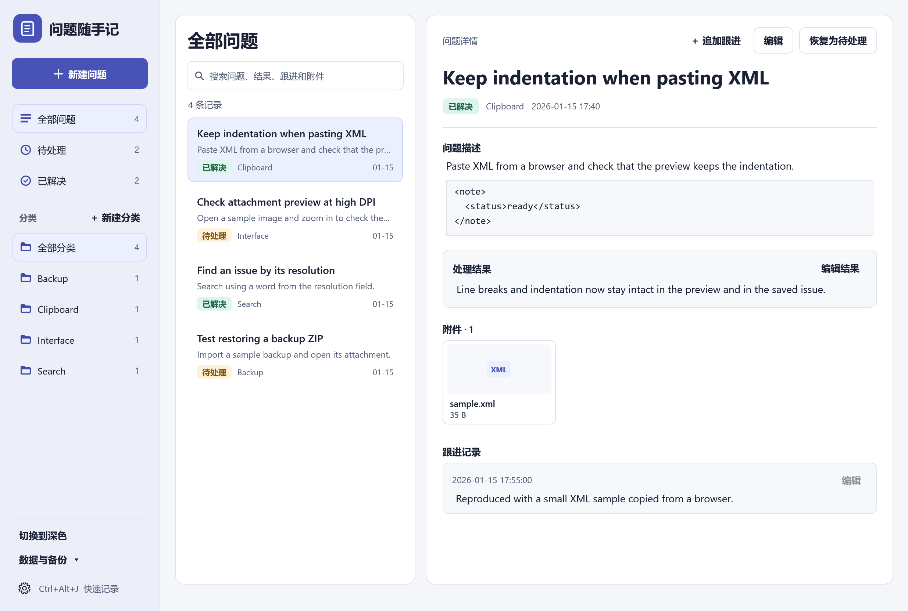

# 问题随手记

[English documentation](README.en.md)

问题随手记是一个 Windows 本地工具，用来记录开发中遇到的问题、复现过程、跟进进展和处理结果。可以把截图、日志等文件放在同一条记录里，之后按关键词、分类或状态找回。

**IssuePocket** is an offline issue log for Windows. Press `Ctrl + Alt + J` while it’s running to log a bug, paste a screenshot or attach a log, and record the fix so you can find it later. Your records stay on your computer. The interface is in Simplified Chinese.

[Download the Windows EXE](https://github.com/Asuralj/issue-pocket/releases/download/v2.2.4/IssuePocket-v2.2.4.exe) · [Noncommercial license](LICENSE)



## 下载和运行

1. 到 [v2.2.4 发布页](https://github.com/Asuralj/issue-pocket/releases/tag/v2.2.4)，在 **Assets** 中下载 `IssuePocket-v2.2.4.exe`。
2. 把 EXE 放到常用的文件夹，双击运行。软件使用 .NET Framework，需要支持该运行环境的 Windows。本版本在 Windows 11 环境构建。
3. 如果电脑上已运行旧版，先在系统托盘右键点击「问题随手记」，选「退出」，再打开新版。

## 记录和跟进问题

1. 在主窗口点击「新建问题」，或在软件运行时按默认快捷键 `Ctrl + Alt + J`。标题可以留空，软件会用描述首行作为标题。
2. 在「问题描述」里写下现象和复现步骤。可输入或选择分类，初次记录时可保留「待处理」状态，填完后保存。
3. 在主窗口选中这条记录。用「追加跟进」记录每次进展，用「填写结果」保存最后的处理方法。已有的跟进可单独编辑。
4. 处理完成后点击「标为已解决」。如果问题再次出现，可以点「恢复为待处理」。

左侧可以按状态或分类筛选，也可以新建分类。中间的搜索框可以查标题、描述、处理结果、跟进内容、分类和附件名。搜索和筛选可以一起使用。如果找不到记录，先点「清除筛选」再重新搜索。

## 截图、附件和代码

- **截图**：复制截图后，在问题编辑窗口粘贴。点击已保存记录中的图片可预览，滚动鼠标滚轮缩放，放大后按住鼠标左键拖动查看。
- **其他文件**：点击「添加文件…」或把文件拖进编辑窗口。软件会保存一份副本。已保存的附件可以打开或另存。
- **代码和表格**：可直接粘贴多行 XML 等代码，或用三反引号围出代码块。Markdown 表格也可以粘贴到描述或处理结果中。点击字段旁的「预览」检查格式。

## 快捷键与托盘

点击主窗口的齿轮打开「设置」。在「快速记录快捷键」里点击键位按钮，直接按下单键或组合键，再点「应用」。如果提示键位被占用，就换一组。启用「开机自启」后，登录 Windows 时软件会驻留系统托盘。

关闭主窗口会将软件隐藏到托盘，快捷键仍可用。要重新显示主窗口，可以双击托盘图标。要彻底关闭软件，在托盘图标上点右键并选择「退出」。

## 备份和换电脑

数据保存在当前 Windows 用户的 `%LOCALAPPDATA%\问题随手记`。可通过「数据与备份」→「打开数据文件夹」找到它。只复制 EXE 时，问题记录和附件仍在原电脑。

1. 在原电脑选择「数据与备份」→「备份到 ZIP…」，保存备份文件。
2. 把备份 ZIP 复制到新电脑，打开问题随手记，选择「数据与备份」→「从备份导入…」。
3. 导入会加入新记录，跳过已经存在的记录。导入后可以抽查问题和附件，并在新电脑上按需设置快捷键和自启。

## 从源码编译

下载或克隆本仓库，在 Windows 上打开 PowerShell，进入仓库目录后运行以下命令。脚本使用 Windows .NET Framework 的 C# 编译器与 WPF 库，输出路径必须是尚不存在的 `.exe` 文件。`-ExecutionPolicy Bypass` 只在这次启动的 PowerShell 进程中生效。

```powershell
powershell.exe -NoProfile -ExecutionPolicy Bypass -File '.\源码\打包新版.ps1' -OutputPath '.\IssuePocket-v2.2.4.exe'
```

当前版本的界面和启动入口在 `源码/现代界面`，数据存储及搜索代码在 `源码` 根目录。用于读取剪贴板 HTML 的 HtmlAgilityPack 已随源码附带，打包时会嵌入 EXE。

## 授权

**源码和 EXE 均仅供非商业使用。** 可以免费用于个人学习、研究和其他非商业活动，也可以为非商业目的修改和分享。分享原版或修改版时须保留许可和权利声明，并注明做过的修改。

未经项目权利人另行书面授权，不得用于商业活动。这包括企业经营中的内部使用、商业项目、收费服务、销售或收费分发，以及把软件集成到商业产品中。具体条款见 [LICENSE](LICENSE)。第三方组件 HtmlAgilityPack 适用其 [MIT 许可证](源码/第三方/HtmlAgilityPack/LICENSE.txt)。
